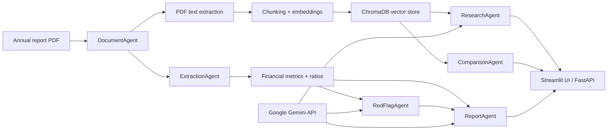
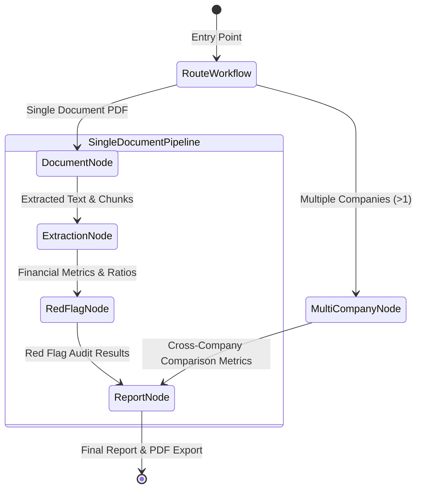
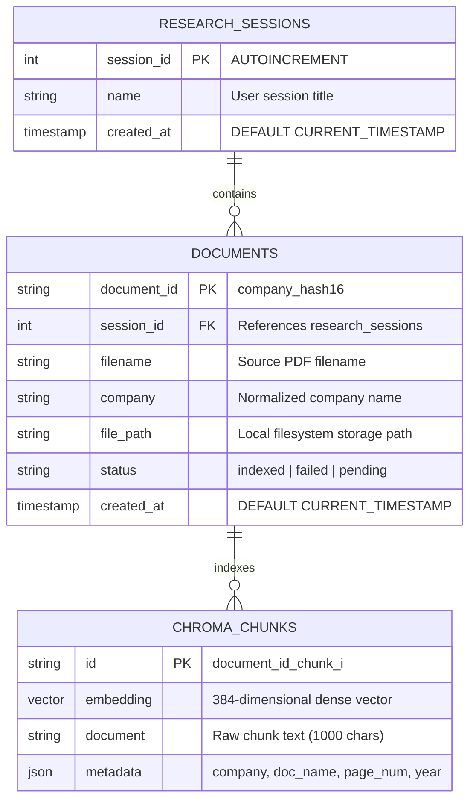
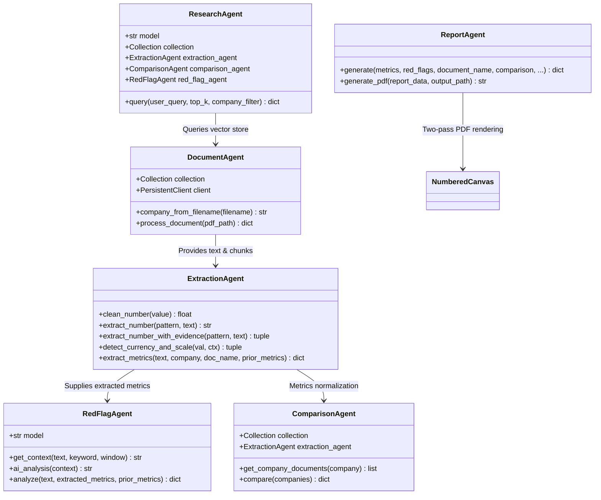
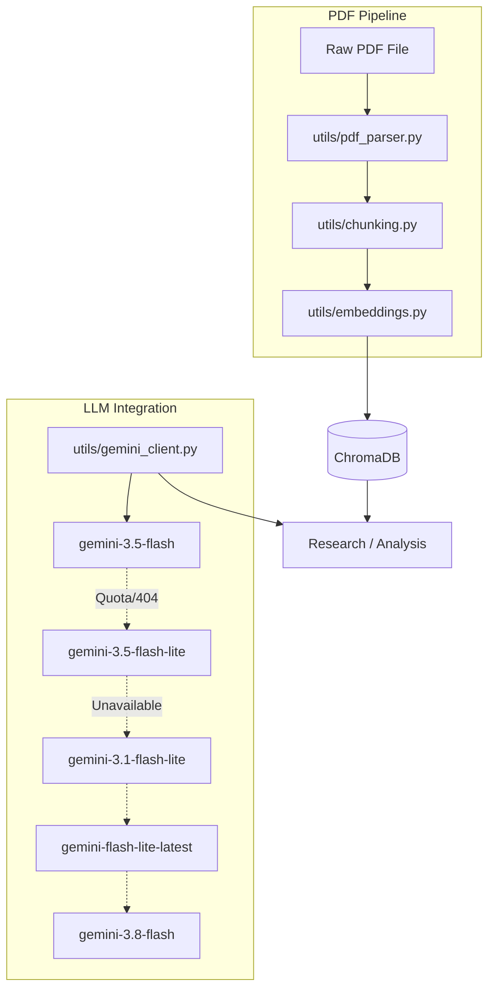
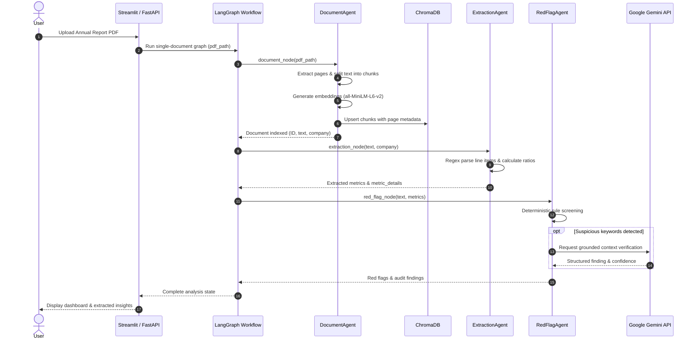
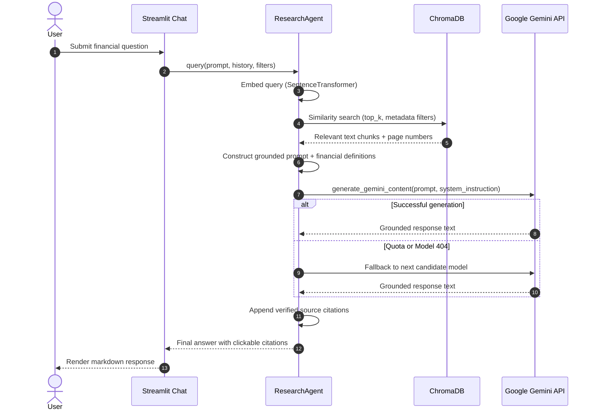

# Financial Multi-Agent System

A local financial-report research and analysis application for annual-report PDFs. The project combines PDF extraction, semantic retrieval, financial metric extraction, risk review, and an interactive UI for research and comparison.

The system is designed to be evidence-first: when extracted numbers or findings are missing or ambiguous, the app leaves them as `N/A` or `null` instead of inventing a value. Gemini is used for grounded reasoning and response synthesis, but citations and retrieved evidence remain essential.

## What this project does

- Upload and process annual-report PDFs
- Extract document text and segment it into chunks
- Embed chunks with SentenceTransformers and store them in ChromaDB
- Extract core financial metrics and ratios from the report text
- Identify potential red flags from the document text and prior metrics
- Support research questions over indexed documents
- Compare companies and financial periods across indexed reports
- Generate summary-style financial reports from extracted data

## Architecture overview



## Project structure

```text
Financial_Multi_Agent/
├── agents/
│   ├── comparison_agent.py
│   ├── document_agent.py
│   ├── extraction_agent.py
│   ├── red_flag_agent.py
│   ├── report_agent.py
│   └── research_agent.py
├── backend/
│   └── main.py
├── data/
│   ├── seed_documents/
│   └── uploads/
├── frontend/
│   └── app.py
├── utils/
│   ├── chunking.py
│   ├── embeddings.py
│   ├── gemini_client.py
│   ├── paths.py
│   └── pdf_parser.py
├── workflow/
│   └── graph.py
├── database.py
├── requirements.txt
├── run_app.cmd
├── research.db
├── vector_db/
├── .env
├── .gitignore
├── LICENSE
└── README.md
```

## Requirements

- Python 3.10 or newer
- Windows, macOS, or Linux
- Internet access for the first embedding-model download
- A Google Gemini API key for LLM-backed analysis and research

## Local configuration

Create a `.env` file in the project root and add your key. Do not commit this file.

```dotenv
GEMINI_API_KEY=your_google_ai_studio_key
GEMINI_MODEL=gemini-3.5-flash
```

Optional overrides are supported for local data locations:

```dotenv
FINANCIAL_DB_PATH=research.db
CHROMA_DB_PATH=vector_db
FINANCIAL_UPLOAD_DIR=data/uploads
```

Notes:
- `GOOGLE_API_KEY` is also accepted by the client code.
- `GEMINI_MODEL` defaults to `gemini-3.5-flash` with automatic fallback across active models (`gemini-3.5-flash-lite`, `gemini-3.1-flash-lite`, `gemini-flash-lite-latest`) when quota or rate limits are reached.
- Relative paths resolve from the repository root.

## Installation

From the project root:

```bash
python -m venv .venv
.\.venv\Scripts\activate
python -m pip install --upgrade pip
pip install -r requirements.txt
```

## Running the app

Start the API in one terminal:

```powershell
python -m uvicorn backend.main:app --reload --host 127.0.0.1 --port 8000
```

Start the UI in another terminal:

```powershell
python -m streamlit run frontend/app.py --server.address 127.0.0.1 --server.port 8501
```

Windows convenience script:

```cmd
run_app.cmd
```

Open the app here:
- Streamlit UI: http://127.0.0.1:8501
- FastAPI docs: http://127.0.0.1:8000/docs
- Health check: http://127.0.0.1:8000/health

## Core app flow

1. Upload a PDF through Streamlit or the API.
2. The document agent extracts text from the PDF.
3. Text is split into chunks and embedded in ChromaDB.
4. The workflow runs metric extraction and red-flag analysis.
5. Research, comparison, and report features query the stored evidence.
6. Results are surfaced through the Streamlit dashboard or the REST API.

## UI pages

The Streamlit app includes these sections:

- Dashboard
- Research Chat
- Company Comparison
- Reports
- Indexed Documents

The UI can operate without the API if needed, but the backend is required for the full REST interface and shared document/session flow.

## API overview

The backend is defined in `backend/main.py` and exposes these main endpoints:

| Method | Endpoint | Description |
| --- | --- | --- |
| `GET` | `/health` | Returns backend status and Gemini configuration state |
| `POST` | `/sessions` | Creates a research session |
| `GET` | `/sessions` | Lists created sessions |
| `GET` | `/documents` | Lists uploaded document records |
| `GET` | `/companies` | Lists company names available in indexed documents |
| `POST` | `/upload?session_id=<id>` | Uploads a PDF and processes it through the workflow |
| `POST` | `/research` | Queries indexed reports with a natural-language prompt |
| `POST` | `/compare` | Compares indexed companies and documents |
| `POST` | `/report` | Builds a report from supplied metrics and findings |
| `GET` / `POST` | `/config` | Reads or updates the in-process Gemini config |

Upload constraints:
- Only PDFs are accepted
- Maximum PDF size: 50 MB
- Document processing errors are surfaced as client or server errors and logged server-side

## Key implementation notes

- `database.py` initializes SQLite tables for sessions and document metadata
- `workflow/graph.py` orchestrates the LangGraph pipeline
- `agents/document_agent.py` extracts text and stores chunk metadata
- `agents/extraction_agent.py` parses financial metrics and ratios
- `agents/red_flag_agent.py` reviews risk and unusual patterns
- `agents/research_agent.py` answers questions with vector retrieval and Gemini
- `agents/comparison_agent.py` groups and compares company documents
- `agents/report_agent.py` assembles report sections from extracted data

## Low-Level Design (LLD)

This section details the internal software architecture, data schemas, state machines, agent execution logic, and integration protocols powering the Financial Multi-Agent System.

### 1. LangGraph Workflow & State Machine

The core analytical pipeline is modeled as a directed acyclic state graph using **LangGraph** (`workflow/graph.py`), enabling deterministic state tracking, dynamic branching, and fault isolation.



#### 1.1 State Schema (`FinancialState`)

All nodes read from and write to a shared, immutable-pattern `TypedDict` state (`FinancialState`):

```python
class FinancialState(TypedDict, total=False):
    pdf_path: str                             # Filesystem path to incoming target PDF
    company: str                              # Normalized company identifier
    companies: list[str]                      # Multi-company comparison target list
    document_result: dict                     # Ingestion metadata (ID, chunk count, status)
    text: str                                 # Complete extracted document text
    extracted_metrics: dict                   # Parsed metrics, units, and financial ratios
    red_flag_result: dict                     # Audit opinion, rule-based & AI risk findings
    historical_documents: list[dict[str, Any]]# Past indexed documents for YoY trend analysis
    research_findings: list[dict[str, Any]]   # Query-specific RAG retrieval context
    comparison_documents: list[dict[str, Any]]# Cross-company benchmark datasets
    sources: list[dict[str, Any]]             # Document traceability metadata
    report: dict[str, Any]                    # Assembled structured report payload
    report_pdf_path: str                      # Absolute path to generated ReportLab PDF
    error: str                                # Failure message if execution halts
```

#### 1.2 Graph Nodes & Transitions

1. **`route_workflow(state)`**: Dynamic entry router. Checks if `state["companies"]` has multiple entities. If yes, diverts to `multi_company_node`; otherwise, routes to `document_node`.
2. **`document_node(state)`**:
   - Sanitizes and infers company name from filename (`DocumentAgent.company_from_filename`).
   - Retrieves historical periods from ChromaDB via `ComparisonAgent.get_company_documents`.
   - Runs full document ingestion: text extraction, chunking, dense vector embedding, and ChromaDB upsert.
   - Extracts complete raw text via `extract_text_from_pdf` for downstream pattern matching.
3. **`extraction_node(state)`**:
   - Executes regex-based targeted section extraction (Income Statement, Balance Sheet, Cash Flows).
   - Computes derived financial ratios (Margins, ROE, ROA, Current Ratio, Debt-to-Equity).
   - Performs prior-period delta comparisons if historical metrics exist.
4. **`red_flag_node(state)`**:
   - Screens text for auditor qualifications (Qualified, Adverse, Disclaimer).
   - Evaluates financial anomalies (e.g., negative operating cash flow with positive net profit, extreme leverage).
   - Extracts local text context windows (±300 characters) and executes Google Gemini verification.
5. **`multi_company_node(state)`**:
   - Queries ChromaDB for all specified company names.
   - Reconstructs document metrics, runs individual red-flag analyses, and merges comparison tables.
6. **`report_node(state)`**:
   - Consolidates metrics, findings, red flags, and historical/peer benchmarks into a unified report dictionary.
   - Invokes `ReportAgent.generate_pdf` using ReportLab Platypus to output a formal PDF.

---

### 2. Storage & Data Models

The system maintains a dual-database design separating relational operational metadata from high-dimensional vector embeddings.



#### 2.1 Relational Schema (SQLite - `database.py`)

- **Connection Management**: Persistent SQLite connection with foreign key enforcement (`PRAGMA foreign_keys = ON`) and 30-second busy timeout (`PRAGMA busy_timeout = 30000`).
- **`research_sessions`**: Tracks user investigation sessions.
- **`documents`**: Tracks uploaded PDFs, processing state, and association with research sessions.

#### 2.2 Vector Database Schema (ChromaDB - `agents/document_agent.py`)

- **Collection Name**: `financial_documents`.
- **Vector Dimension**: 384 dimensions (`all-MiniLM-L6-v2` SentenceTransformer).
- **ID Strategy**: `{company}_{file_hash[:16]}_chunk_{i}`, where `file_hash` is SHA-256 computed from raw PDF bytes.
- **Metadata Structure**:
  ```json
  {
    "document_id": "Apple_Inc_a1b2c3d4e5f60718",
    "company": "Apple Inc",
    "document_name": "Apple_FY2023_10K.pdf",
    "chunk_number": 14,
    "page_number": 8,
    "financial_year": "2023",
    "indexed_at": "2026-10-19T12:00:00Z"
  }
  ```

---

### 3. Agent Class Specifications & Internal Logic

Each agent operates as a specialized, decoupled worker adhering to single-responsibility principles.



#### 3.1 `DocumentAgent` (`agents/document_agent.py`)
- **PDF Extraction**: Calls `utils.pdf_parser.extract_pages_from_pdf` to capture page-indexed text. Fallback to `extract_text_from_pdf` if page parsing encounters non-standard stream structures.
- **Chunking Pipeline**: Utilizes `utils.chunking.split_pages` (1,000 characters chunk size, 200 character overlap) while preserving the original PDF page number on each chunk.
- **Fingerprinting & De-duplication**: Generates 16-character SHA-256 hash from file bytes.
- **Fiscal Year Extraction**: Multi-tier regex inspecting terms like `Financial Year 20XX`, `Fiscal Year ended ... 20XX`, `10-K ... 20XX`, or filename tokens (`FY20XX`).
- **Upserting**: Writes vector batches into ChromaDB with comprehensive metadata for scoped filtering.

#### 3.2 `ExtractionAgent` (`agents/extraction_agent.py`)
- **Cleaning Engine (`clean_number`)**: Strips currency symbols (`₹`, `$`, `€`, `£`, `Rs.`, `INR`), handles comma delimiters, and converts parenthesized financial notation `(1,234.50)` into negative floats `-1234.50`.
- **Targeted Section Matching**: Scores document sections using heading markers (e.g., `Statement of Profit and Loss`, `Balance Sheet`, `Cash Flow Statement`) to eliminate false positives from introductory notes.
- **Currency & Scale Normalization (`detect_currency_and_scale`)**: Identifies currency denomination (`INR`, `USD`, `EUR`, `GBP`) and reporting unit (`Crore`, `Lakh`, `Billion`, `Million`, `Thousand`), enabling standardized cross-company comparison.
- **Extracted Line Items**:
  - Income Statement: Revenue, Operating Profit (EBIT), Net Profit / PAT, Basic & Diluted EPS.
  - Balance Sheet: Total Assets, Total Liabilities, Total Debt / Borrowings, Cash & Equivalents, Net Worth / Equity.
  - Cash Flow Statement: Operating Cash Flow (CFO), Capital Expenditures (Capex), Free Cash Flow (FCF = CFO - Capex).
- **Calculated Ratios**:
  $$\text{Operating Margin} = \frac{\text{Operating Profit}}{\text{Revenue}} \times 100$$
  $$\text{Net Profit Margin} = \frac{\text{Net Profit}}{\text{Revenue}} \times 100$$
  $$\text{ROE} = \frac{\text{Net Profit}}{\text{Shareholders' Equity}} \times 100$$
  $$\text{Current Ratio} = \frac{\text{Current Assets}}{\text{Current Liabilities}}$$
  $$\text{Debt-to-Equity} = \frac{\text{Total Debt}}{\text{Shareholders' Equity}}$$
- **Evidence-First Traceability**: For every extracted value, generates a `metric_details` entry containing raw text snippet, surrounding context, page number, and whether it was directly extracted or computed.

#### 3.3 `RedFlagAgent` (`agents/red_flag_agent.py`)
- **Dual-Layer Evaluation**:
  1. **Deterministic Rule Engine**:
     - *Audit Opinions*: Scans for "qualified opinion", "adverse opinion", and "disclaimer of opinion" while actively excluding negated patterns (e.g., "we have issued an unqualified opinion" or "without qualifying our opinion").
     - *Financial Anomaly Tests*: Flags divergence between Net Profit and Operating Cash Flow (e.g., profit increasing while CFO is negative), high leverage (Debt-to-Equity > 2.5), and severe margin contraction (> 500 bps drop YoY).
  2. **Grounded AI Analysis (`ai_analysis`)**:
     - Extracts a window of ±300 characters around suspicious keywords (e.g., *material weakness*, *investigation*, *restatement*, *default*, *going concern*).
     - Submits context to Gemini with strict guidelines: prohibits hallucination, forbids treating generic boilerplate risk disclosures or normal accounting policies as red flags.
     - Structured response parser extracts: `Finding`, `Potential Red Flag (Yes/No)`, `Confidence (High/Medium/Low)`, `Reason`, and `Evidence`.

#### 3.4 `ResearchAgent` (`agents/research_agent.py`)
- **Semantic Query Pipeline**:
  1. Vectorizes user query with `all-MiniLM-L6-v2`.
  2. Performs vector similarity search in ChromaDB, applying metadata filters (`company`, `document_id`) when provided.
  3. Injects internal domain definitions (`FINANCIAL_CONCEPTS`: definitions and standard calculation formulas for EPS, Revenue, Margins, ROE, Debt, etc.).
  4. Formulates a grounded RAG prompt requiring specific page and document citations.
  5. Fallback logic: If vector search produces low-confidence matches, runs lexical fallback queries across extracted metrics and indexed document names.
- **Conversation State**: Maintains multi-turn conversation memory (up to 20 turns) to resolve contextual follow-up questions.

#### 3.5 `ComparisonAgent` (`agents/comparison_agent.py`)
- **Entity Aggregation**: Queries all chunks in ChromaDB belonging to designated company names.
- **Metric Extraction Across Periods**: Automatically executes `ExtractionAgent` on reconstructed text segments for each document.
- **Temporal Alignment**: Orders documents chronologically by inferred fiscal year to compute YoY growth rates for revenue, margins, and leverage.

#### 3.6 `ReportAgent` (`agents/report_agent.py`)
- **Structured Assembly**: Combines executive summary, company profile, financial metrics table, computed ratios, red flag analysis, and source citations.
- **Professional PDF Engine (ReportLab Platypus)**:
  - Custom `NumberedCanvas` performing a two-pass canvas render to calculate total page count (`"Page X of Y"`).
  - Dynamically draws running header rules and footer metadata with source timestamps on all pages following the cover.
  - Applies cohesive styling: Navy primary (`#14263D`), Accent Blue (`#1D4ED8`), Slate border (`#D7E0EA`), and Charcoal text (`#1B2B42`).
  - Auto-wraps table cells in Platypus `Paragraph` elements to prevent text clipping.

---

### 4. Utilities & Integration Infrastructure



#### 4.1 `utils/pdf_parser.py`
- Implements `extract_pages_from_pdf` using `pypdf.PdfReader` with `strict=False` to tolerate minor PDF compliance defects.
- Detects encryption; attempts blank-password decryption before raising clear exception messages.
- Returns list of dictionaries: `[{"page_number": int, "text": str}]`.

#### 4.2 `utils/chunking.py`
- Utilizes LangChain's `RecursiveCharacterTextSplitter`.
- Parameters: `chunk_size=1000`, `chunk_overlap=200`, separators `["\n\n", "\n", " ", ""]`.
- `split_pages` iterates page by page, preserving page attribution across chunks.

#### 4.3 `utils/embeddings.py`
- Employs `sentence-transformers/all-MiniLM-L6-v2` producing 384-dimensional dense vectors.
- Decorates loader with `@lru_cache(maxsize=1)` to prevent re-instantiating model weights across requests.
- Enforces `TOKENIZERS_PARALLELISM="false"` to prevent deadlocks under FastAPI / Streamlit worker threads.

#### 4.4 `utils/gemini_client.py`
- Wraps the new `google-genai` SDK (`google.genai.Client`).
- **Resilient Fallback Ladder**:
  $$\text{gemini-3.5-flash} \longrightarrow \text{gemini-3.5-flash-lite} \longrightarrow \text{gemini-3.1-flash-lite} \longrightarrow \text{gemini-flash-lite-latest} \longrightarrow \text{gemini-3.8-flash}$$
- **Error Handling & Backoff**:
  - `404` or `RESOURCE_EXHAUSTED` / `Quota exceeded`: Immediately advances to next candidate model without wasting retries.
  - `429` / `503` (Transient/Rate limits): Applies exponential sleep backoff ($0.5 \times (\text{attempt} + 1)$ seconds).
  - `API_KEY_INVALID`: Raises immediate terminating `GeminiError` to alert the operator.

---

### 5. API Data Contracts & Pydantic Models

FastAPI (`backend/main.py`) validates incoming and outgoing payloads via Pydantic v2:

| Model Name | Fields | Validation Constraints | Purpose |
| --- | --- | --- | --- |
| `SessionCreate` | `name: str` | $1 \le \text{length} \le 200$ | Create research session |
| `ResearchRequest` | `query: str`<br>`top_k: int = 5`<br>`company: str \| None`<br>`document_id: str \| None`<br>`conversation_history: list` | $1 \le \text{len(query)} \le 5000$, non-blank<br>$1 \le \text{top\_k} \le 20$<br>Max 20 conversation history turns | Parameterize RAG research query |
| `ComparisonRequest` | `companies: list[str] \| None` | Optional company filter list | Filter multi-company comparison |
| `ReportRequest` | `metrics: dict`<br>`red_flags: dict`<br>`document_name: str`<br>`comparison: dict`<br>`findings: list \| None`<br>`sources: list \| None` | Structured metric dictionary and optional findings/sources | Request PDF or structured report generation |
| `ConfigRequest` | `gemini_api_key: str \| None`<br>`gemini_model: str \| None` | API key or model string | Dynamically reconfigure Gemini parameters at runtime |

---

### 6. End-to-End Sequence Diagrams

#### 6.1 Document Ingestion & Analysis Flow



#### 6.2 Research Query (RAG) Execution Flow



## Validation

The system components can be verified directly through:
- **Streamlit Interface**: Open http://127.0.0.1:8501, upload an annual report PDF from the sidebar, review extracted metrics on the Dashboard, query financial facts in Research Chat, run cross-company comparisons, and generate source-linked reports.
- **FastAPI Endpoints**: Open interactive API documentation at http://127.0.0.1:8000/docs or inspect `/health` to verify service readiness and Gemini connectivity.

## Limitations and cautions

- Extraction is pattern-based and depends on text being present in the PDF. Scanned or image-only PDFs may not work reliably.
- Values are not audited financial statements; they should be manually reviewed against the original document.
- Financial years are inferred from text when available; missing or ambiguous years remain `N/A`.
- Ratios are computed only when required inputs are available.
- Comparison and red-flag findings should be reviewed carefully when currencies, units, or reporting periods differ.
- ChromaDB and SQLite are local persistent stores; back up the data before deleting or replacing them.

## Security and environment guidance

- Keep `.env` local to the machine and never commit it to source control.
- Avoid sharing your Gemini API key in screenshots, logs, or issue reports.
- If the app reports missing Gemini configuration, add a valid key to `.env` and check the selected model is enabled for your Google account.
