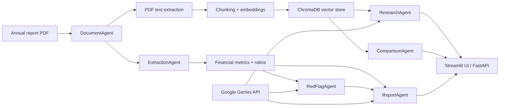

# Financial Multi-Agent System

A local financial-report research and analysis application for annual-report PDFs. The project combines PDF extraction, semantic retrieval, financial metric extraction, risk review, and an interactive UI for research and comparison.

The system is designed to be evidence-first: when extracted numbers or findings are missing or ambiguous, the app leaves them as `N/A` or `null` instead of inventing a value. Gemini is used for grounded reasoning and response synthesis, but citations and retrieved evidence remain essential.

## What this project does

- Upload and process annual-report PDFs
- Extract document text and segment it into chunks
- Embed chunks with SentenceTransformers and store them in ChromaDB
- Extract core financial metrics and ratios from the report text
- Identify potential red flags from the document text and prior metrics
- Support research questions over indexed documents
- Compare companies and financial periods across indexed reports
- Generate summary-style financial reports from extracted data

## Architecture overview



## Project structure

```text
Financial_Multi_Agent/
├── agents/
│   ├── comparison_agent.py
│   ├── document_agent.py
│   ├── extraction_agent.py
│   ├── red_flag_agent.py
│   ├── report_agent.py
│   └── research_agent.py
├── backend/
│   └── main.py
├── data/
│   ├── seed_documents/
│   └── uploads/
├── frontend/
│   └── app.py
├── utils/
│   ├── chunking.py
│   ├── embeddings.py
│   ├── gemini_client.py
│   ├── paths.py
│   └── pdf_parser.py
├── workflow/
│   └── graph.py
├── database.py
├── requirements.txt
├── run_app.cmd
├── run.ps1
├── research.db
├── vector_db/
├── .env
├── .gitignore
├── LICENSE
└── README.md
```

## Requirements

- Python 3.10 or newer
- Windows, macOS, or Linux
- Internet access for the first embedding-model download
- A Google Gemini API key for LLM-backed analysis and research

## Local configuration

Create a `.env` file in the project root and add your key. Do not commit this file.

```dotenv
GEMINI_API_KEY=your_google_ai_studio_key
GEMINI_MODEL=gemini-3.5-flash
```

Optional overrides are supported for local data locations:

```dotenv
FINANCIAL_DB_PATH=research.db
CHROMA_DB_PATH=vector_db
FINANCIAL_UPLOAD_DIR=data/uploads
```

Notes:
- `GOOGLE_API_KEY` is also accepted by the client code.
- `GEMINI_MODEL` defaults to `gemini-3.5-flash` with automatic fallback across active models (`gemini-3.5-flash-lite`, `gemini-3.1-flash-lite`, `gemini-flash-lite-latest`) when quota or rate limits are reached.
- Relative paths resolve from the repository root.

## Installation

From the project root:

```powershell
python -m venv .venv
.\.venv\Scripts\Activate.ps1
python -m pip install --upgrade pip
pip install -r requirements.txt
```

## Running the app

Start the API in one terminal:

```powershell
python -m uvicorn backend.main:app --reload --host 127.0.0.1 --port 8000
```

Start the UI in another terminal:

```powershell
python -m streamlit run frontend/app.py --server.address 127.0.0.1 --server.port 8501
```

Windows convenience scripts:

- PowerShell:
  ```powershell
  .\run.ps1
  ```
- Command Prompt:
  ```cmd
  run_app.cmd
  ```

Open the app here:
- Streamlit UI: http://127.0.0.1:8501
- FastAPI docs: http://127.0.0.1:8000/docs
- Health check: http://127.0.0.1:8000/health

## Core app flow

1. Upload a PDF through Streamlit or the API.
2. The document agent extracts text from the PDF.
3. Text is split into chunks and embedded in ChromaDB.
4. The workflow runs metric extraction and red-flag analysis.
5. Research, comparison, and report features query the stored evidence.
6. Results are surfaced through the Streamlit dashboard or the REST API.

## UI pages

The Streamlit app includes these sections:

- Dashboard
- Research Chat
- Company Comparison
- Reports
- Indexed Documents

The UI can operate without the API if needed, but the backend is required for the full REST interface and shared document/session flow.

## API overview

The backend is defined in `backend/main.py` and exposes these main endpoints:

| Method | Endpoint | Description |
| --- | --- | --- |
| `GET` | `/health` | Returns backend status and Gemini configuration state |
| `POST` | `/sessions` | Creates a research session |
| `GET` | `/sessions` | Lists created sessions |
| `GET` | `/documents` | Lists uploaded document records |
| `GET` | `/companies` | Lists company names available in indexed documents |
| `POST` | `/upload?session_id=<id>` | Uploads a PDF and processes it through the workflow |
| `POST` | `/research` | Queries indexed reports with a natural-language prompt |
| `POST` | `/compare` | Compares indexed companies and documents |
| `POST` | `/report` | Builds a report from supplied metrics and findings |
| `GET` / `POST` | `/config` | Reads or updates the in-process Gemini config |

Upload constraints:
- Only PDFs are accepted
- Maximum PDF size: 50 MB
- Document processing errors are surfaced as client or server errors and logged server-side

## Key implementation notes

- `database.py` initializes SQLite tables for sessions and document metadata
- `workflow/graph.py` orchestrates the LangGraph pipeline
- `agents/document_agent.py` extracts text and stores chunk metadata
- `agents/extraction_agent.py` parses financial metrics and ratios
- `agents/red_flag_agent.py` reviews risk and unusual patterns
- `agents/research_agent.py` answers questions with vector retrieval and Gemini
- `agents/comparison_agent.py` groups and compares company documents
- `agents/report_agent.py` assembles report sections from extracted data

## Validation

The system components can be verified directly through:
- **Streamlit Interface**: Open http://127.0.0.1:8501, upload an annual report PDF from the sidebar, review extracted metrics on the Dashboard, query financial facts in Research Chat, run cross-company comparisons, and generate source-linked reports.
- **FastAPI Endpoints**: Open interactive API documentation at http://127.0.0.1:8000/docs or inspect `/health` to verify service readiness and Gemini connectivity.

## Limitations and cautions

- Extraction is pattern-based and depends on text being present in the PDF. Scanned or image-only PDFs may not work reliably.
- Values are not audited financial statements; they should be manually reviewed against the original document.
- Financial years are inferred from text when available; missing or ambiguous years remain `N/A`.
- Ratios are computed only when required inputs are available.
- Comparison and red-flag findings should be reviewed carefully when currencies, units, or reporting periods differ.
- ChromaDB and SQLite are local persistent stores; back up the data before deleting or replacing them.

## Security and environment guidance

- Keep `.env` local to the machine and never commit it to source control.
- Avoid sharing your Gemini API key in screenshots, logs, or issue reports.
- If the app reports missing Gemini configuration, add a valid key to `.env` and check the selected model is enabled for your Google account.
